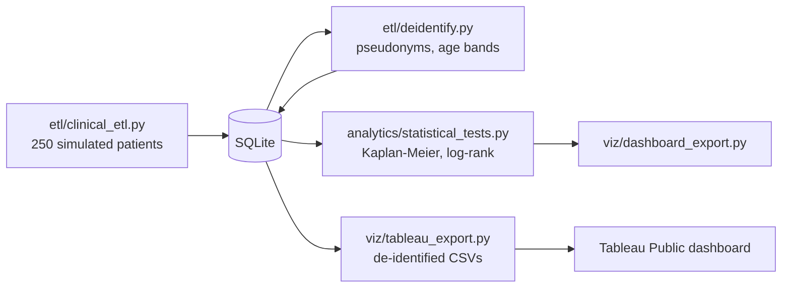
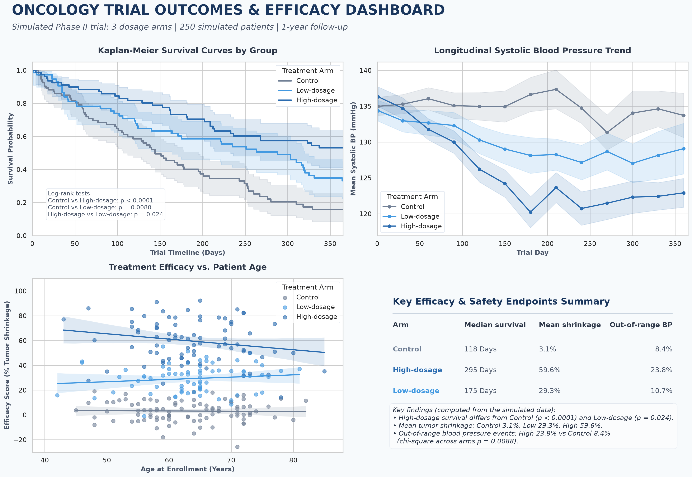

# Clinical Trials Patient Outcomes Analysis

[](https://github.com/Deshraj-Jogiya/Clinical-Trials-Outcomes-Analysis/actions/workflows/ci.yml) 

A clinical-trial analysis pipeline on simulated data: SQL and Python ingestion of patient survival, vitals and dosage records, Kaplan-Meier
survival curves and log-rank tests across three treatment arms, and a de-identified copy of the patient table for analysis.

## Highlights

- **Ingestion and cleaning** of patient survival, vital signs and dosage records into SQLite.
- **Survival analysis:** Kaplan-Meier curves and pairwise log-rank tests (lifelines) compare survival across 3 treatment arms; a chi-square test
  (SciPy) compares adverse-event rates.
- **De-identification:** `etl/deidentify.py` builds `patients_deidentified`, replacing patient IDs with keyed SHA-256 pseudonyms and exact
  ages with 5-year bands; covered by `tests/test_deidentify.py`.
- **Reporting:** Tableau extracts (patient outcomes, Kaplan-Meier curve points, log-rank results) and an outcomes dashboard (matplotlib
  preview below). `python make_report.py` refreshes the whole report in one process: **6.3 s instead of 15.5 s** for the four steps run
  as separate scripts, **60% faster**, with identical extracts (`python make_report.py --benchmark`, best of 3).

Measured results, each with the question, the test and the decision: [docs/FINDINGS.md](docs/FINDINGS.md).

## Architecture





## Stack

Python, SQL, SQLite, pandas, lifelines, SciPy, Matplotlib, Tableau Public, pytest, GitHub Actions.

## Run it

```bash
pip install -r requirements.txt
python etl/clinical_etl.py
python etl/deidentify.py
python analytics/statistical_tests.py
python viz/dashboard_export.py
python viz/tableau_export.py     # writes exports/*.csv for the Tableau dashboard
python make_report.py                 # ETL, statistics, Tableau extracts and dashboard in one go
python -m pytest tests/ -v
```

## Data

The 250 patient records are simulated (seeded); no real patient data is used.
